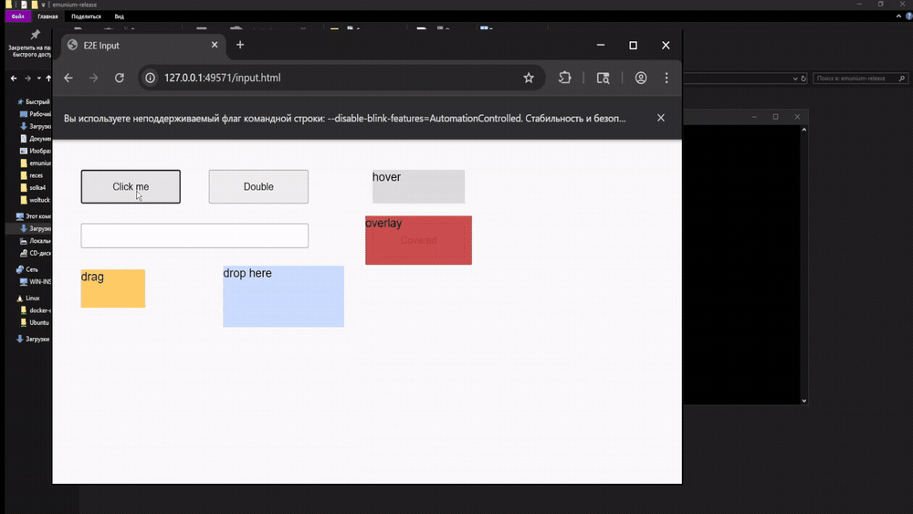

# Emunium

**Browser automation that uses the real mouse and keyboard.**

Emunium reads the page through a small Chrome extension and acts through the
operating system: every click is a real cursor movement, and before the button
goes down emunium checks that the page sees the pointer over the right element.
No CDP, no WebDriver.

- **Verified clicks** at any DPI, page zoom or monitor layout: a click that
  would land on the wrong element raises an error instead of pressing.
- **Unicode typing on Windows and Linux that ignores the keyboard layout**:
  Cyrillic, CJK and emoji go out as keystrokes, not through the clipboard.
- **Typed errors instead of silent failures**: stale elements, closed tabs, lost
  focus and blocked scripts each raise their own exception.
- **Isolated sessions**: every browser has its own extension copy, port and
  token, so parallel runs don't collide.
- **Natural-looking input**: pointer paths from pluggable motion planners and a
  typing rhythm with word, sentence and key-pair pauses, each with presets.

A standalone mode drives any desktop application through image template
matching and OCR.



---

## Table of Contents

- [Installation](#installation)
- [Browser mode](#browser-mode)
- [Navigation](#navigation)
- [Waiting](#waiting)
- [Element API](#element-api)
- [Mouse and keyboard](#mouse-and-keyboard)
- [Human-like input](#human-like-input)
- [Tabs](#tabs)
- [Network waits](#network-waits)
- [JavaScript execution](#javascript-execution)
- [Errors](#errors)
- [Screen coordinates, DPI and zoom](#screen-coordinates-dpi-and-zoom)
- [Headless mode](#headless-mode)
- [Session isolation](#session-isolation)
- [Standalone mode](#standalone-mode)
- [PageParser and Locator](#pageparser-and-locator)
- [Advanced utilities](#advanced-utilities)
- [Limitations](#limitations)
- [Running the Linux suite](#running-the-linux-suite)

---

## Installation

```bash
pip install emunium
```

Requires Python 3.10 or newer. Runtime dependencies per platform:

| Platform | Installed with `pip install emunium` | Native input through |
|---|---|---|
| Windows | `websockets` | built-in backend: Win32 `SendInput` / `SetCursorPos` via `ctypes` |
| macOS | `websockets`, `pyautogui`, `pyperclip` | `pyautogui` |
| Linux | `websockets`, `pyperclip` | built-in backend: X11 XTest via `ctypes` (X11, or XWayland) |

On Linux, native input needs an X server or XWayland (`DISPLAY` set) and the
system libraries `libX11.so.6` and `libXtst.so.6` (Debian/Ubuntu packages
`libx11-6` and `libxtst6`); no Python package is involved.

`pyperclip` is used on macOS to paste characters that cannot be sent as key
presses (see [Keyboard](#keyboard)); on Linux it is only reached for control
characters. Windows and Linux do not install pyautogui and never import it.

Optional extras:

| Extra | Installs | Unlocks |
|---|---|---|
| `standalone` | `opencv-python-headless`, `numpy`, `mss` | `Emunium.find_elements()` image matching |
| `ocr` | `opencv-python-headless`, `numpy`, `mss`, `easyocr` | `Emunium.find_text_elements()` OCR |
| `parsing` | `selectolax` | `PageParser` / `Locator` queries |
| `keyboard` | `keyboard` | non-ASCII keystrokes on macOS when running as root |

```bash
pip install "emunium[standalone,parsing]"
```

Chrome for Testing is downloaded on first launch (see [ensure_chrome](#ensure_chrome))
unless you point emunium at a binary.

---

## Browser mode

```python
from emunium import Browser, Wait, WaitStrategy

with Browser(user_data_dir="my_profile") as browser:
    browser.goto("https://duckduckgo.com/")

    browser.type('input[name="q"]', "emunium automation")
    browser.click('button[type="submit"]')

    browser.wait(
        "a[data-testid='result-title-a']",
        strategy=WaitStrategy.STABLE,
        condition=Wait().visible().text_not_empty().stable(duration_ms=500),
        timeout=30,
    )

    print(browser.title, browser.url)

    for link in browser.query_selector_all("a[data-testid='result-title-a']")[:5]:
        print(link.text.strip()[:60])
```

`Browser` constructor:

```python
Browser(
    headless=False,
    user_data_dir=None,    # persistent profile dir; a temporary profile if None
    bridge_port=0,         # 0 = OS-assigned port on 127.0.0.1
    bridge_timeout=60.0,   # seconds to wait for the extension to connect
    *,
    chrome_path=None,      # Chrome/Chromium binary; see below
    extra_args=None,       # list[str] of extra Chrome command-line flags
    verify_input=True,     # verify the cursor position before every click
    motion=None,           # pointer planner: "natural" (None), "careful", "brisk" or a MotionPlanner
    typing=None,           # typing rhythm: "natural" (None), "careful", "brisk" or a TypingRhythm
)
```

- `chrome_path` selects the browser binary. Without it, the `EMUNIUM_CHROME_PATH`
  environment variable is used, and without that, Chrome for Testing is
  downloaded. A path that does not exist raises `LaunchError`.
- `extra_args` must be a list of strings; a single string raises `LaunchError`
  instead of being split.
- `verify_input=False` skips the pointer check described in
  [Screen coordinates](#screen-coordinates-dpi-and-zoom) and clicks at the
  computed position.
- `motion` and `typing` choose how `human=True` actions move the cursor and pace
  keystrokes; see [Human-like input](#human-like-input). An unknown preset name
  or a wrong type raises `InvalidArgumentError`.

`launch()` is transactional: if Chrome or the extension fails to start, every
process and temporary directory it created is removed before the error is
raised (`LaunchError`, or the emunium exception that caused the failure). `close()` is safe to call more than once. The
context manager calls both.

On Windows, `launch()` then tries once to bring the browser window to the
foreground (a browser started from a background process can open behind other
windows); a failure there is only logged. Every native action raises the
window again before sending input. On a headed Windows browser, `close()` first
closes the tabs through the extension (up to one second), so Chrome exits on its
own before the process tree is terminated.

Properties: `browser.url`, `browser.title`, `browser.bridge`.

---

## Navigation

```python
result = browser.goto("https://example.com", timeout=30.0, wait_until="load")
# -> PageInfo {"url": ..., "title": ..., "tabId": ..., "contentReady": ...}
result["tabId"]   # dict access, as before
result.tab_id     # the same value as a typed attribute
```

Results of `goto`, `page_info`, `tab_info`, `tabs`, `wait_for_response`,
`expect_response(...).value` and `get_center` are **result records**
(`PageInfo`, `TabInfo`, `NetworkResponse`, `Point` from `emunium`); the
replies of `new_tab`, `switch_to_tab` and `close_tab` are plain `Record`s.
They are `dict` subclasses holding exactly the extension's reply: `x["key"]`,
`==` with a dict, `json.dumps(x)`, `print(x)` and `repr(x)` behave as for the
plain dict. Each key can also be read as a snake_case attribute
(`info.ready_state` is `info["readyState"]`); a missing key raises
`AttributeError` naming the key. `type(x) is dict` is `False`, pickles need
emunium importable to load, and serializers that accept only exact dicts (for
example `yaml.safe_dump`) need `dict(x)`.

`wait_until` is one of:

| Value | `goto` returns when |
|---|---|
| `"commit"` | the navigation is committed |
| `"domcontentloaded"` | the DOM is parsed |
| `"load"` (default) | the page `load` event fired |

A navigation that does not finish in time raises `NavigationTimeoutError`; one
that fails (DNS error, aborted, blocked) raises `NavigationError`. The tab that
was navigated becomes the pinned tab (see [Tabs](#tabs)).

```python
browser.wait_for_idle(silence=2.0, timeout=30.0)  # -> bool
```

`wait_for_idle` returns `True` once `document.readyState` is `"complete"` both
before and after `silence` seconds, `False` when `timeout` runs out. Only the
transient error of a document swap is retried; any other error propagates.

```python
browser.page_info()  # PageInfo: url, title, readyState, scrollX, scrollY, scrollWidth, scrollHeight, geometry
browser.page_info().ready_state  # also .url, .title, .scroll_x, .scroll_y, .scroll_width, .scroll_height
browser.scroll_to(element_or_selector)  # scroll the element into view
browser.scroll_to(x, y)                 # scroll the page to absolute CSS pixel coords
```

---

## Waiting

### Simple waits

```python
browser.wait_for_element(selector, timeout=10.0)  # CSS
browser.wait_for_xpath(xpath, timeout=10.0)
browser.wait_for_text(text, timeout=10.0)
```

Each returns an `Element` and raises `WaitTimeoutError` (a `TimeoutError`)
when nothing matched in time; see [Errors](#errors) for its message and hint.

### Waits with conditions

```python
browser.wait(
    selector,
    strategy=None,          # WaitStrategy or None
    condition=None,         # Wait builder (or its payload list)
    timeout=10.0,
    raise_on_timeout=True,  # False: return None instead of raising TimeoutError
)
```

`Wait()` is a fluent builder. Chained conditions are ANDed:

```python
browser.wait("#results", condition=Wait().visible().text_not_empty().stable(500))
```

| Method | Satisfied when |
|---|---|
| `.visible()` | rendered (not `display: none`, not `visibility: hidden`/`collapse`, opacity above 0) with a box that is non-zero in at least one dimension |
| `.clickable()` | visible, enabled, `pointer-events` is not `none` |
| `.stable(duration_ms=300)` | the bounding rect is unchanged for `duration_ms` |
| `.unobscured()` | no other element covers its center point |
| `.hidden()` | the element exists but is not visible |
| `.detached()` | no element matches (removed or never appeared) |
| `.text_not_empty()` | inner text is non-empty after trimming |
| `.text_contains(sub)` | inner text contains `sub` |
| `.has_attribute(name, value=None)` | the attribute is present (and equals `value` if given) |
| `.without_attribute(name)` | the attribute is absent |
| `.has_class(name)` | the CSS class is present |
| `.has_style(prop, value)` | the computed style property equals `value` |
| `.count_gt(n)` | more than `n` elements match |
| `.count_eq(n)` | exactly `n` elements match |
| `.custom_js(code)` | `code` is a function body run in the page with `el` bound to the element; its return value is truthy |
| `.any_of(*waits)` | at least one group holds (OR) |
| `.all_of(*waits)` | every group holds (explicit AND) |
| `.not_(wait)` | the group does not hold |

`WaitStrategy` values: `PRESENCE`, `VISIBLE`, `CLICKABLE`, `STABLE`, `UNOBSCURED`.

An unknown condition is rejected with `InvalidArgumentError` before waiting.
A `custom_js` condition is compiled once, before the wait starts, and then
evaluated on every check:

- A syntax error raises `ScriptError` immediately, without waiting out the
  timeout.
- Code that the page's Content Security Policy refuses to compile raises
  `CSPBlockedError` (emunium first retries through the `userScripts` API, which
  pages cannot block).
- An exception thrown while the condition runs counts as `False` ("not yet"):
  the wait keeps checking and, if the condition never holds, ends with
  `WaitTimeoutError` (a `TimeoutError`) after the wait's timeout.
- A condition that returns a promise or other thenable raises `ScriptError`;
  `custom_js` must return synchronously.

```python
# Either a success marker or a captcha box
browser.wait(
    "body",
    condition=Wait().any_of(
        Wait().has_class("success-loaded"),
        Wait().text_contains("Verify you are human"),
    ),
    timeout=15,
)

# Until the button is no longer disabled
browser.wait("#submit", condition=Wait().not_(Wait().has_attribute("disabled")))
```

### Waits without an element

A wait that is satisfied by the absence of an element returns `None`, because
there is no element to hand back:

```python
browser.click("#submit-btn")
browser.wait(".loading-spinner", condition=Wait().detached(), timeout=20)  # -> None
```

`.hidden()` returns the (still attached) element.

### Soft waits

```python
promo = browser.wait(".promo-modal", condition=Wait().visible(),
                     timeout=3.0, raise_on_timeout=False)
if promo:
    promo.click()
```

A soft wait that times out and a satisfied element-less wait (such as
`.detached()`) both return `None`.

---

## Element API

`Element` handles are returned by query and wait methods.

```python
browser.query_selector(selector)        # -> Element | None
browser.query_selector_all(selector)    # -> list[Element]
browser.get_by_text(text, exact=False)  # -> list[Element] (deepest matches only)
browser.get_all_interactive()           # -> list[Element]
```

Properties: `element_id`, `tag`, `text`, `attrs`, `rect` (CSS px, viewport
relative), `center` (CSS px), `screen_x`, `screen_y` (screen input coordinates),
`visible`, `tab_id`, `zoom`.

```python
element.click(human=True, offset_x=None, offset_y=None)
element.double_click(human=True)
element.right_click(human=True)
element.middle_click(human=True)
element.hover(offset_x=None, offset_y=None, human=True)
element.move_to(offset_x=None, offset_y=None, human=True)   # same as hover
element.type(text, characters_per_minute=None, offset=None, human=True,
             click_type=ClickType.LEFT, settle=True)
element.drag_to(target_element, human=True)
element.scroll_into_view()
element.focus()
element.get_attribute(name)
element.get_computed_style(prop)
element.refresh(requery=True)
```

- Offsets are CSS pixels from the element's top-left corner. Without them a
  random point in the central part of the element is used.
- An element handle belongs to the document and tab it was found in. Actions
  always address that tab, so a handle from another tab still acts on its own
  tab (which is activated first). A handle whose node was removed, or whose page
  navigated away, raises `StaleElementError`.
- `refresh()` re-reads the element; when it is stale, it is found again with
  the query that produced it (same selector and index). With `requery=False`, or
  when the query no longer finds an element of the same tag, `StaleElementError`
  is raised.

---

## Mouse and keyboard

### Mouse

```python
browser.click(selector, human=True, click_type=ClickType.LEFT, timeout=10.0)
browser.click_at(target, click_type=ClickType.LEFT, human=True, timeout=10.0)
browser.move_to(target, offset_x=None, offset_y=None, human=True, timeout=10.0)
browser.hover(target, ...)                      # same as move_to
browser.drag_and_drop(source, target, human=True, timeout=10.0)
browser.get_center(target)                      # -> Point {"x": int, "y": int}; also .x, .y
```

`target` is a CSS selector or an `Element`. A selector is resolved with
`wait_for_element(selector, timeout)`. Each method returns the element it acted
on (`drag_and_drop` returns `None`).

`ClickType` values: `LEFT` (default), `RIGHT`, `MIDDLE`, `DOUBLE`. A double click
is one cursor movement followed by two presses at the OS double-click interval.

`human=True` moves the cursor along a path planned by the browser's motion
planner (see [Human-like input](#human-like-input)); `human=False` puts it on
the target in one step.

A drag verifies the drop target while the button is held. If verification
fails after the button went down, the cursor returns to the source, Escape is
sent to cancel the drag, and only then is the button released.

### Keyboard

```python
browser.type(selector, text, characters_per_minute=None, offset=None, human=True, timeout=10.0)
browser.type_at(target, text, ..., click_type=ClickType.LEFT)
```

Typing clicks the element (with the same verification as a click), then checks
that the element holds keyboard focus and that the browser window has OS focus.
If it does not after one `focus()` retry, `NativeInputError` is raised and no
keys are sent. Focus is checked again between chunks of text, so typing stops
as soon as focus moves elsewhere.

`Element.type(..., settle=True)` (the default) then waits until the page shows
the typed text, returning after at most 2 seconds with a logged warning;
`settle=False` returns as soon as the keys are sent. `Browser.type` and
`Browser.type_at` take no `settle` parameter and always wait this way.

How characters are delivered:

- **Windows**: every character is sent with `SendInput` as a Unicode keystroke
  (`KEYEVENTF_UNICODE`). The active keyboard layout does not matter: Cyrillic,
  CJK, accented letters and emoji are typed as keystrokes, never pasted. `\n`
  is sent as Enter and `\t` as Tab.
- **Linux**: every character is typed as a keystroke through X11 XTest,
  whatever the keyboard layout. A character the layout lacks (Cyrillic on a US
  layout, CJK, emoji) is typed on a spare keycode that emunium maps to it for a
  moment and restores afterwards; nothing is pasted. Run one emunium process
  per X display (one worker per display or Xvfb): two processes typing such
  characters on the same display can interfere.
- **macOS**: printable ASCII, `\n` and `\t` are typed as key presses.
  Other characters are typed with the `keyboard` package when it is installed
  and the process runs as root; otherwise they are pasted through the clipboard
  (`Cmd+V`). The previous clipboard text is restored afterwards if the
  clipboard still holds the pasted text.

`human=True` waits between keystrokes as the browser's typing rhythm draws it
(see [Typing rhythm](#typing-rhythm)). `characters_per_minute` (60 to 900)
overrides the rhythm's median speed and `offset` (milliseconds, 0 to 1000 and
below the median interval `60000 / characters_per_minute`) its random jitter;
`None` keeps the rhythm's own values. With `human=True`, a value outside these
ranges raises `InvalidArgumentError` before any key is sent.
`characters_per_minute` of 0 or less, like
`human=False`, types without delay between keystrokes.

### Fail-safe

- **Windows and Linux**: with the cursor in a corner of the primary screen (on
  Linux, of the X screen), the next native action is refused with
  `NativeInputError`. Set `EMUNIUM_FAILSAFE=0` to disable this check.
- **macOS**: pyautogui's own fail-safe applies and raises
  `pyautogui.FailSafeException`. `EMUNIUM_FAILSAFE` has no effect there.

---

## Human-like input

With `human=True` (the default) the cursor travels to its target along a
planned path and keystrokes follow a variable rhythm, modelled on published
models of human pointing and typing. The goal is input that looks natural to a
person watching the screen and to pages that react to pointer movement. emunium
makes no claim that this input is indistinguishable from a person's or that it
avoids bot detection.

### Motion planners

```python
from emunium import Browser, Emunium, SigmaDriftPlanner, WindMousePlanner

browser = Browser(motion="careful")                        # preset of the default planner
browser = Browser(motion=WindMousePlanner.preset("brisk"))
emu = Emunium(motion=SigmaDriftPlanner(sample_hz=250.0))  # standalone mode takes the same argument
```

`motion=` (on `Browser` and `Emunium`) is `None` (the `natural` preset of
`SigmaDriftPlanner`), a preset name (`"natural"`, `"careful"`, `"brisk"`, all
of `SigmaDriftPlanner`), or a planner object. Every planner except
`LinearPlanner` has `Planner.preset("natural" | "careful" | "brisk")`:
`careful` moves slower with more corrections, `brisk` faster.

| Planner | Path |
|---|---|
| `SigmaDriftPlanner` (default) | Sigma-lognormal strokes (Plamondon) along a gently curved path; duration from Fitts' law; tremor and slow drift; sometimes an overshoot or undershoot followed by a corrective sub-stroke. |
| `BezierTremorPlanner` | Cubic Bezier curve (occasionally S-shaped) walked with a minimum-jerk speed profile; tremor and drift; occasional overshoot with a straight corrective approach. |
| `WindMousePlanner` | Benjamin Land's WindMouse (gravity pulls toward the target, wind wanders), reported at a mouse polling rate. |
| `LinearPlanner` | One step straight onto the target, no delay. |

Move duration follows Fitts' law, `a + b * log2(D / W + 1)`, where `D` is the
distance and `W` the target size: for element actions, the smaller side of the
element's visible box in screen pixels (24 px when no element size is known,
for example in standalone mode). The duration varies randomly from move to move and
stays within 0.12 to 1.6 seconds for every preset (`natural` at most 1.2 s,
`brisk` 0.9 s). On Windows, steps are timed with a 1 ms timer resolution while
the move plays; a step that falls behind schedule is skipped rather than
delayed. The built-in planners keep intermediate steps inside the virtual
screen and off its corners and the primary monitor's corners (the fail-safe);
on Windows, emunium also moves them onto a real monitor of a mixed
multi-monitor layout. Every move ends exactly on the target.

Parameters are dataclass fields; every value is checked on construction and an
out-of-range value raises `InvalidArgumentError` naming the parameter and its
range. Pairs are `(low, high)` ranges a value is drawn from.

| Object | Parameter (range) |
|---|---|
| `FittsTiming` (`timing=` of each planner except `LinearPlanner`) | `a` 0 to 0.3 s, `b` 0.05 to 0.3 s/bit, `variability` 0 to 0.35, `min_duration` 0.12 to 0.6 s, `max_duration` 0.3 to 1.6 s; `min_duration < max_duration` and `a + b <= max_duration` |
| `Tremor` (`tremor=`) | `frequency_hz` 4 to 15 Hz, `amplitude_px` 0 to 2 px, `drift_px` 0 to 3 px; `amplitude_px[1] + drift_px <= 4` px. Tremor is also capped at a quarter of the target size and fades out before the end of the move. |
| `Overshoot` (`overshoot=`) | `probability` 0 to 1, `share` 0 to 0.15 of the distance, `px` 0 to 80 px, `slack_px` 0 to 10 px; only for moves of at least 3 target sizes |
| `SigmaDriftPlanner` | `sigma` 0.08 to 0.16, `primary_fraction` 0.85 to 1.0, `correction_probability` 0 to 1, `correction_onset` 0.5 to 2.5 sigma, `correction_ratio` 0.3 to 1.0, `curvature` 0 to 0.3, `sample_hz` 60 to 1000 Hz |
| `BezierTremorPlanner` | `curvature` 0 to 0.3, `s_curve_probability` 0 to 1, `correction_share` 0.05 to 0.4, `sample_hz` 60 to 1000 Hz |
| `WindMousePlanner` | `gravity` 1 to 20, `wind` 0 to 10 (at most `gravity`), `max_step` 3 to 50 px, `target_area` 1 to 50 px, `sample_hz` 60 to 1000 Hz |

```python
from emunium import FittsTiming, Overshoot, SigmaDriftPlanner, Tremor

planner = SigmaDriftPlanner(
    timing=FittsTiming(a=0.12, b=0.14, max_duration=1.4),
    overshoot=Overshoot(probability=0.1),
    tremor=Tremor(amplitude_px=(0.2, 0.8), drift_px=0.5),
)
```

### Custom planners

Any object with a `plan` method matching the `MotionPlanner` protocol can be
passed as `motion=`:

```python
import random

from emunium import Browser, MotionStep, ScreenBounds


class StraightPlanner:
    """Twenty evenly spaced steps over 0.3 seconds."""

    def plan(self, start: tuple[int, int], end: tuple[int, int], *,
             target_size: float, rng: random.Random,
             bounds: ScreenBounds | None = None) -> list[MotionStep]:
        steps = []
        for i in range(1, 21):
            t = i / 20
            x = round(start[0] + (end[0] - start[0]) * t)
            y = round(start[1] + (end[1] - start[1]) * t)
            steps.append(MotionStep(x, y, 0.015))
        return steps


browser = Browser(motion=StraightPlanner())
```

`MotionStep(x, y, dt)` means "`dt` seconds after the previous step, put the
cursor on `(x, y)`" in screen input coordinates. `target_size` is Fitts' `W`
in the same unit; `rng` is the random generator to draw from; `bounds`, when
given, is the virtual screen the steps should stay inside. The last step
should be `end`: emunium places the cursor exactly on the target after the
last step in any case. Keeping the other steps on screen and off its corners
is the planner's job; on Windows, emunium additionally moves them onto the
nearest monitor and off the corners.

### Typing rhythm

```python
from emunium import Browser, TypingRhythm

browser = Browser(typing="brisk")
browser = Browser(typing=TypingRhythm(characters_per_minute=320, word_pause=(1.8, 2.8)))
```

`typing=` (on `Browser` and `Emunium`) is `None` (the `natural` preset), a
preset name, or a `TypingRhythm`. The wait between two keystrokes is:

1. a lognormal base interval with median `60 / characters_per_minute` seconds
   and spread `sigma` (cut at 3 sigma);
2. multiplied by `word_pause` after a space or tab, or by `sentence_pause`
   after a line break or after `.`, `!`, `?` or `…` followed by whitespace or
   the end of the text;
3. multiplied by `shift_pause` before an ASCII capital or shifted symbol;
4. multiplied by a US-QWERTY bigram factor: `alternate_hand` when the keys use
   different hands, `roll` for neighbouring fingers of one hand, `same_finger`
   when one finger types both; 1.0 for other pairs and for non-ASCII
   characters;
5. plus, with probability `micro_pause_probability`, a pause drawn from
   `micro_pause` seconds;
6. plus a random jitter of up to `jitter_ms` milliseconds either way (the
   `offset` argument of `type`);
7. never shorter than 15 ms.

| Preset | `characters_per_minute` | `jitter_ms` | Character |
|---|---|---|---|
| `natural` (default) | 280 | 20 | average typist |
| `careful` | 200 | 15 | slower, longer word and sentence pauses |
| `brisk` | 420 | 10 | faster, shorter pauses |

Ranges: `characters_per_minute` 60 to 900, `sigma` 0.1 to 0.6, `word_pause`
1 to 4, `sentence_pause` 1 to 6, `shift_pause` 1 to 2, `alternate_hand` 0.5 to
1, `roll` 0.5 to 1, `same_finger` 1 to 2, `micro_pause_probability` 0 to 0.1,
`micro_pause` 0 to 2 s, `jitter_ms` 0 to 1000 ms and below the median interval
`60000 / characters_per_minute` ms, `dwell` 0.03 to 0.25 s, `dwell_sigma` 0 to
0.5. `dwell` and `dwell_sigma` describe key hold time, but the built-in
backends send each keystroke's down and up events together, so they currently
have no effect on typing.

### `human=False`

`human=False` skips both models: the cursor is put on the target in one step
and keys are sent without delay between them. Everything else stays the same:
clicks are still verified, typing still checks focus, and a headless browser
still refuses native input.

---

## Tabs

Commands without an explicit tab go to the **pinned tab**. The pin follows what
the user sees: the initial tab after `launch()`, the tab `goto()` navigated, a
tab opened by `new_tab()`, a tab chosen with `switch_to_tab()`, and the active
tab after the pinned tab is closed.

```python
info = browser.new_tab("https://example.com")              # opens, activates and pins it
bg = browser.new_tab("https://example.org", switch=False)  # opens in the background, pin unchanged
browser.tabs()               # -> [TabInfo {"tabId", "url", "title", "active", "windowId"}, ...]
browser.switch_to_tab(bg["tabId"])  # activates the tab, focuses its window, pins it
browser.switch_to_tab(bg.tab_id)    # the same, through the record attribute
browser.tab_info()           # pinned tab: TabInfo {"tabId", "url", "title", "status", "active", "windowId"}
browser.close_tab()          # closes the pinned tab, then pins the active tab
browser.close_tab(tab_id)    # closes a specific tab
```

`switch_to_tab` requires an `int` tab id (`InvalidArgumentError` otherwise). A
command sent to a tab that no longer exists raises `TargetClosedError`.

---

## Network waits

```python
browser.click("#fetch-data")
response = browser.wait_for_response("*/api/v1/users*", timeout=10.0)
if response:
    print(response["statusCode"], response["url"])
    print(response.status, response.url, response.ok)  # NetworkResponse attributes
```

`wait_for_response(url_pattern, timeout=10.0, *, since=None, any_tab=False)`
returns the first matching response, or `None` on timeout.

- `url_pattern` is matched against the whole URL. `*` matches any run of
  characters; every other character, including `?`, `.` and `[`, is literal.
- Only responses of the pinned tab are considered unless `any_tab=True`.
- `since` is an epoch timestamp in milliseconds. Responses that finished before
  it are ignored. By default it is the start of the last action emunium
  recorded for this browser: the `Browser` methods `goto`, `click`, `type`,
  `execute_script`, `new_tab`, `scroll_to` and the other input methods, plus
  the pointer check of a verified click. Element-level actions (`element.click()`,
  `element.type()`, ...) with `verify_input=False` do not advance it, so after
  those pass `since=` yourself if an earlier response could match.

Entries look like
`{"url", "statusCode", "method", "type", "timeStamp", "tabId", "requestId"}`, plus
`"error"` for requests that failed at the network level. They are returned as
`NetworkResponse` records: `.url`, `.status` (`statusCode`), `.method`, `.type`,
`.tab_id`, `.request_id`, `.timestamp` (`timeStamp`, epoch ms), `.error` (`None`
unless the request failed) and `.ok` (status 200-399 and no error). The
extension keeps the last 500 responses from the last two minutes.

To wait for a response caused by a specific block of code, use
`expect_response`:

```python
with browser.expect_response("*/api/search*", timeout=10.0) as resp:
    browser.click("#search")
print(resp.value["statusCode"], resp.value.status)
```

The time window starts when the block is entered and the timeout runs from
when it exits. The tab is the pinned tab at entry (`any_tab=True` widens it). If
no response matches, `WaitTimeoutError` (a `TimeoutError`) is raised on exit. If the block itself
raises, nothing is awaited and the exception propagates.

---

## JavaScript execution

```python
title = browser.execute_script("return document.title")
data = browser.execute_script("const r = await fetch('/api/me'); return r.json();")
```

The code is the body of a function run in the page: use `return` to produce a
value; a returned promise is awaited. The result is converted to a JSON value:

- `undefined` becomes `None`; `NaN` and infinities become `None`.
- Circular references become `"[Circular]"`, `window` becomes `"[Window]"`.
- DOM nodes become `{"nodeType", "nodeName", "id", "className"}`.
- Errors become `{"name", "message"}`; values that cannot be read become
  `"[Unserializable]"`.

A script that throws raises `ScriptError`. A page whose Content Security Policy
forbids evaluation raises `CSPBlockedError` (emunium first retries through the
`userScripts` API, which pages cannot block). A result larger than about 32 MiB
raises `ScriptError`.

---

## Errors

Every emunium exception derives from `EmuniumError` and carries `.message`,
`.code` (the bridge error code, or `None`), `.method` (the bridge command, or
`None`) and `.hint` (a suggested next step, or `None`). `str(exc)` is the
message, followed by a `hint: ...` line when there is a hint; the hint survives
pickling. All classes are importable from `emunium` and `emunium.errors`.

```text
EmuniumError
  BridgeError                       the bridge transport itself failed
    BridgeDisconnectedError         also ConnectionError: the extension disconnected
    BridgeTimeoutError              also TimeoutError: no reply arrived in time
    BridgeProtocolError             malformed frame or unknown command
  CommandError                      a command reached the extension and failed
    StaleElementError               the element handle no longer refers to a node
    TargetClosedError               the tab is gone
    ContentUnavailableError         the page cannot be scripted (e.g. chrome:// pages)
    InvalidArgumentError            also ValueError
    CommandTimeoutError             also TimeoutError
      WaitTimeoutError
    NavigationError                 also RuntimeError
      NavigationTimeoutError        also TimeoutError
    ScriptError                     also RuntimeError
      CSPBlockedError
  NativeInputError                  also RuntimeError: OS input unavailable or refused
    ClickVerificationError          the cursor could not be verified over the element
  LaunchError                       also RuntimeError: Chrome or the extension did not start
  ElementNotFoundError              also LookupError: a selector resolved to no element to act on
  ExpectationError                  also AssertionError: an expectation did not hold in time
```

Because the timeout classes also derive from `TimeoutError` and the others from
the matching built-in, `except TimeoutError:`, `except LookupError:` and similar
handlers keep working.

The element waits (`wait`, `wait_for_element`, `wait_for_xpath`,
`wait_for_text`, and every action that takes a selector) raise
`WaitTimeoutError` chained from the extension's error. The message names the
page, and the hint comes from one count of the selector's matches taken after
the timeout (left out when that count fails):

```text
Element not found after 10.0s: '#save' (url=https://example.com/form, title='Form')
hint: 2 element(s) match but none satisfied conditions clickable
```

`no element matches '#save' on this page` means the selector itself is wrong or
the content has not loaded. A headless browser refusing native input, a click
that could not be verified and a window that delivers no pointer events also
carry hints.

```python
from emunium import NativeInputError, StaleElementError

try:
    button.click()
except StaleElementError:
    button.refresh().click()
except NativeInputError as exc:
    print("cannot click:", exc.message)
    if exc.hint:
        print("try:", exc.hint)
```

---

## Screen coordinates, DPI and zoom

- On Windows, `import emunium` makes the process per-monitor DPI aware
  (`PER_MONITOR_AWARE_V2`, with older fallbacks). Screen coordinates are then
  physical pixels on every monitor. Import emunium **before** pyautogui or any
  GUI toolkit: whichever library sets DPI awareness first wins, and emunium
  does not fail if it was set already.
- Element positions are converted from CSS pixels to screen input coordinates
  using the window position and size, the page zoom and `devicePixelRatio`. On
  macOS the unit is points; on Windows and Linux it is physical pixels.
  Multi-monitor desktops, including monitors at negative coordinates, are
  supported.
- The estimate is calibrated from real pointer events: after the first move,
  the position the page reports for the cursor is used to correct the mapping
  for that browser. Moving or resizing the window, or changing the zoom, discards
  the calibration.
- With `verify_input=True` (default) every click is preceded by a check that the
  page saw the pointer over the target element (or one of its descendants). A
  miss is corrected up to two times; then `ClickVerificationError` is raised and
  no button is pressed. If the page receives no pointer event at all (window
  minimized, covered by another window, or off-screen), `NativeInputError` is
  raised.
- `Element.screen_x` / `screen_y` give the element center in screen input
  coordinates, calibrated when a calibration exists.

---

## Headless mode

`Browser(headless=True)` starts Chrome with `--headless=new`. Navigation,
queries, waits, tabs, network waits and `execute_script` work. A headless
browser has no window to send OS input to, so every native-input method
(`click`, `click_at`, `type`, `type_at`, `move_to`, `hover`, `drag_and_drop`,
and the matching `Element` methods) raises `NativeInputError`. `human=False`
does not change this.

---

## Session isolation

Every `Browser` gets its own session:

- a temporary session directory with a private copy of the extension and a
  session file holding the bridge port and a random token;
- a WebSocket bridge on `127.0.0.1` (OS-assigned port by default). Every
  connection must present that token. Connections whose `Origin` header is not
  `chrome-extension://...` (that is, web pages) are rejected; a connection
  without an `Origin` header is allowed but still needs the token. Only one
  connection is active at a time;
- its own Chrome process (on Windows, the whole process tree is owned by a job
  object and terminated with the session).

Several `Browser` instances can run in parallel in one or more processes
without sharing a port file or extension state. Native input is serialized
within a process, so their clicks and keystrokes never interleave. `close()`
removes the session directory and a temporary profile; a `user_data_dir` you
passed is kept.

---

## Standalone mode

Desktop automation without a browser, via screenshots (`mss`) and template
matching (OpenCV). Requires `emunium[standalone]`; OCR requires `emunium[ocr]`.

```python
from emunium import ClickType, Emunium

emu = Emunium()
matches = emu.find_elements("search_icon.png", min_confidence=0.8)
if matches:
    emu.click_at(matches[0], ClickType.LEFT)

fields = emu.find_elements("text_field.png", min_confidence=0.85)
if fields:
    emu.type_at(fields[0], "hello world")
```

With OCR (EasyOCR is initialized in the constructor, so a missing model or
package fails here rather than at the first search):

```python
emu = Emunium(ocr_enabled=True, use_gpu=True, langs=["en"])   # ocr=True is an alias
hits = emu.find_text_elements("Sign in", min_confidence=0.8)
if hits:
    emu.click_at(hits[0])
```

- `find_elements(image_path, min_confidence=0.8, target_height=None,
  target_width=None, max_elements=0, region=None)` returns `{"x", "y"}` match
  centers in screen input coordinates, best score first, with overlapping
  duplicates removed. Templates are searched at several scales (0.9, 1.0,
  1.1), rotations (-10, 0, +10 degrees) and contrasts. `region` is
  `(left, top, width, height)` in screen input coordinates and may be negative
  on multi-monitor desktops. `max_elements=0` means no limit.
- `find_text_elements(query, min_confidence=0.8, max_elements=0, region=None)`
  raises `RuntimeError` when OCR was not enabled.
- `wait_for_image(...)` and `wait_for_text_ocr(...)` poll until a match appears;
  they raise `TimeoutError`, or return `None` with `raise_on_timeout=False`.
- `move_to(center)`, `click_at(center, click_type)`, `type_at(center, text)`,
  `type_text(text)`, `drag_and_drop(start, end)` and `scroll_to(center)` (mouse
  wheel notches until the point is near the vertical middle of the screen)
  use the same native input as browser mode, including layout-independent
  typing on Windows. Standalone clicks are not verified: there is no page to
  confirm them.
- `Emunium(motion=..., typing=...)` selects the pointer planner and typing
  rhythm exactly like `Browser` (see [Human-like input](#human-like-input)).
  `type_at` and `type_text` take the same `characters_per_minute` and `offset`
  overrides as `Browser.type`.

---

## PageParser and Locator

Offline HTML parsing with CSS selectors. No browser needed. Requires
`emunium[parsing]`.

```python
from emunium import PageParser

html = browser.execute_script("return document.documentElement.outerHTML")
parser = PageParser(html)

links = parser.locator("a[href]").all()
btn = parser.get_by_text("Sign in", exact=True).first
inputs = parser.get_by_role("textbox").all()
field = parser.get_by_placeholder("Search").first
email = parser.get_by_label("Email address").first
submit = parser.get_by_test_id("submit-btn").first
```

`Locator` supports `.first`, `.last`, `.nth(i)`, `.all()`, `.count()`,
`.inner_text()`, `.get_attribute(name)` and `.filter(has_text=...)`.

Without selectolax every query method raises `ImportError` (an empty result
would be indistinguishable from "no match"); only `parser.title` falls back to
a regular expression.

---

## Advanced utilities

- `Bridge` - the WebSocket transport to the extension, for custom commands
  outside the `Browser` facade. Its methods return plain data and raise the
  exceptions in [Errors](#errors).
- `CoordsStore` / `ElementRecord` - a thread-safe cache of element rects.

### ensure_chrome

```python
from emunium import ensure_chrome

path = ensure_chrome()
```

Returns `EMUNIUM_CHROME_PATH` when set (raising `LaunchError` if it points to a
missing file); otherwise downloads the current stable Chrome for Testing build
for the platform if it is not installed yet, and returns its path. Installation
is atomic and safe against concurrent installers. `Browser.launch()` calls it
when no `chrome_path` is given.

---

## Limitations

- **Chrome/Chromium only**, version 116 or newer. The bridge is a Manifest V3
  extension loaded with `--load-extension`; branded Google Chrome builds from
  version 137 ignore that flag, so use Chrome for Testing (the default) or
  Chromium.
- **Top frame only.** Queries, waits and element actions do not reach into
  iframes.
- **Native input needs a visible, focused window.** The browser window must be
  on screen and not covered at the click point; typing requires OS focus. On
  Windows, emunium brings the browser window to the foreground before native
  input (without sending any keys or clicks to do so) and raises
  `NativeInputError` when Windows keeps another window in front. On macOS and
  Linux it relies on the extension focusing the window. Real input moves the
  real cursor: do not use the mouse or keyboard while a script runs.
- **No native input in headless mode** (see [Headless mode](#headless-mode)).
- **Linux** native input goes through X11 XTest and requires an X server or
  XWayland (`DISPLAY` set) plus `libx11-6` and `libxtst6`; a pure Wayland
  session without XWayland raises `NativeInputError`. Use one emunium process
  per X display.
- **macOS** requires the Accessibility (and, for standalone screenshots, Screen
  Recording) permission for the terminal or Python process.
- Standalone clicks are not verified, and OCR quality depends on EasyOCR and the
  screen content.

---

## Running the Linux suite

```bash
python tests/docker/run_linux.py
```

Needs Docker. The script builds the `emunium-linux-tests:local` image
(`tests/docker/Dockerfile`: Python 3.10, Debian's Chromium, Xvfb and openbox)
from a temporary context holding only the package, the tests and the project
metadata, then runs the unit suite and the e2e suite (real X11 input against
Chromium) under Xvfb in one container. It prints the tail of the log and exits
with the container's status, non-zero when either suite failed. Options:
`--tail N` (log lines to print, default 60), `--log PATH` (full log, default
`emunium-linux-tests.log` in the temp directory), `--timeout S` (container run
limit, default 1800).

---

## License

MIT
